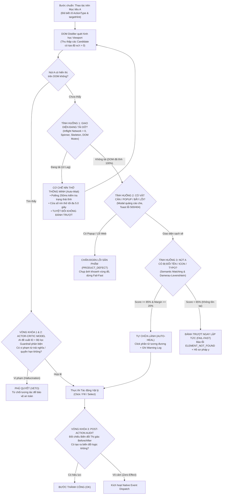

# TÀI LIỆU QUY CHUẨN CƠ CHẾ RA QUYẾT ĐỊNH & HÀNH XỬ HỆ THỐNG CỦA AI (AI DECISION-MAKING & SYSTEM BEHAVIORAL SPECIFICATION)
*Dự án: Enterprise Zero-Selector Web AutoTest Engine*  
*Tiêu chuẩn tham chiếu: Google Test Engineering, Microsoft Playwright Auto-Waiting Architecture, Meta Sapienz, W3C WebDriver BiDi, Explainable AI (XAI)*  
*Cập nhật: 17/11/2026 - Phiên bản 2.1.0 (Bản đặc tả Toàn diện 15 Trụ cột Hành vi)*

---

## 1. TRIẾT LÝ RA QUYẾT ĐỊNH CỦA HỆ THỐNG (SYSTEM PHILOSOPHY)

Trong tự động hóa kiểm thử web hiện đại, một cỗ máy thông minh **không phải là cỗ máy cố gắng bấm bừa để bài test chạy qua**, mà là cỗ máy biết **khi nào nên nín thở chờ đợi, khi nào được phép tự chữa lành, và khi nào bắt buộc phải dừng khẩn cấp (Fail-Fast)** để bảo toàn tính toàn vẹn của dữ liệu kiểm thử.

Hệ thống vận hành dựa trên **3 Không (The 3 Zero-Tolerance Rules)** của Big Tech:
1. **Không đoán mò (Zero Guessing)**: AI không bao giờ được tự sinh ra tọa độ hay selector từ trí tưởng tượng (Anti-Hallucination). Mọi thao tác phải dựa trên các phần tử vật lý thực tế đã được đo lường bằng hình học DOM.
2. **Không bấm ẩu (Zero Reckless Action)**: Không bao giờ được tự động click vào phần tử có nguy cơ gây tác dụng phụ nghịch đảo (ví dụ: cấm click nhầm `Sign Out`, `Delete`, `Cancel`).
3. **Không thử lại mù quáng (Zero Blind Retry)**: Cấm tuyệt đối việc nhồi lệnh reload hoặc click liên tiếp 5-10 lần khi gặp lỗi. Việc retry mù quáng chỉ tạo ra Flaky Tests và phá hủy dữ liệu backend (nhân đôi đơn hàng, khóa tài khoản).

---

## 2. CỖ MÁY TRẠNG THÁI RA QUYẾT ĐỊNH TOÀN DIỆN (THE FINITE STATE DECISION MACHINE)

Khi tiếp nhận một bước kiểm thử chuẩn hóa (ví dụ: `Bấm nút "A"` hoặc `Điền "X" vào ô "Y"`), toàn bộ hệ thống sẽ kích hoạt cỗ máy trạng thái đa tầng dưới đây để đưa ra quyết định hành xử:



---

## 3. QUY CHUẨN XỬ LÝ KHI GIAO DIỆN CHƯA KỊP LOAD (UI LAG & ASYNC RENDER)

### 3.1. Dấu hiệu Nhận diện Trạng thái "Đang Tải" (In-Flight Signals)
Trước khi đưa ra bất kỳ kết luận nào về việc "nút A không tồn tại", hệ thống bắt buộc phải giám sát 3 chỉ số sinh tồn của ứng dụng:
1. **Network Inflight Requests $> 0$**: Trình duyệt đang duy trì các kết nối API (XHR/Fetch) nghiệp vụ chưa nhận được phản hồi HTTP.
2. **Visual Loading Artifacts**: Trên viewport xuất hiện các phần tử xoay vòng, thanh tiến trình hoặc khung xương: `.spinner`, `.loading`, `.skeleton`, `[role="progressbar"]`, các hiệu ứng mờ nhạt (CSS shimmer/pulse).
3. **DOM Mutation Mutex**: Cây DOM liên tục kích hoạt các sự kiện thêm/xóa/sửa node từ React/Vue Virtual DOM trong khoảng thời gian $\Delta t < 100\text{ms}$.

### 3.2. Hành vi Chuẩn hóa của Hệ thống:
* **Cấm đánh trượt**: Giữ kịch bản ở trạng thái chờ tĩnh `STATE_WAITING_FOR_QUIESCENCE`.
* **Cơ chế Nín thở Thông minh (Smart Auto-Waiting)**:
  * Không dùng lệnh `sleep()` cứng ngắc làm lãng phí thời gian.
  * Thiết lập chu kỳ kiểm tra Polling $250\text{ms}$ một lần. Ngay khi Spinner biến mất VÀ Network Inflight $= 0$, hệ thống lập tức quét lại DOM (thường chỉ mất từ $300\text{ms} - 800\text{ms}$).
  * **Hạn mức nín thở tối đa ($T_{\text{max}} = 5.0\text{s}$)**: Nếu sau 5.0 giây mà hệ thống mạng vẫn bị treo hoặc vòng xoay loading không chịu tắt:
    * Kết luận: **`FAILED: INFRA_DEFECT`** (Mã chi tiết: `UI_RENDER_TIMEOUT`).
    * Tránh việc test runner bị treo vô tận làm kẹt hàng đợi CI/CD.

---

## 4. QUY CHUẨN XỬ LÝ KHI NÚT A THỰC SỰ KHÔNG CÓ TRÊN MÀN HÌNH

Khi ứng dụng web đã lắng đọng hoàn toàn ($100\%$ Quiescent) mà phần tử mục tiêu vẫn vắng mặt:

### 4.1. Đánh trượt hay Cho thử lại (Fail-Fast vs. Retry)?
> [!CAUTION]
> **Quy chuẩn Big Tech**: **CẤM RETRY MÙ QUÁNG**.
> Nếu nút "Thêm vào giỏ" không xuất hiện vì người dùng chưa chọn kích thước áo, việc cho kịch bản reload trang hoặc thử click lại 3 lần là hành vi phi logic. Kịch bản phải được đánh giá qua quy trình chẩn đoán 3 cấp:

### 4.2. Quy trình Chẩn đoán 3 Cấp:
1. **Cấp 1 - Kiểm tra Hiện tượng Chặn (Blocker / Overlay Detection)**:
   * Kiểm tra xem màn hình có đang bị che khuất bởi Modal bất ngờ (Popup thông báo hệ thống bảo trì, lỗi mạng 502, hoặc thông báo *"Sản phẩm đã hết hàng"*).
   * Nếu phát hiện lỗi nghiệp vụ hiển thị $\rightarrow$ Gán nhãn `PRODUCT_DEFECT`, chụp ảnh hiện trường và **Dừng ngay lập tức**.
2. **Cấp 2 - Kiểm tra Khả năng Tự Chữa Lành (Semantic Healing)**:
   * Sử dụng AI để tìm kiếm phần tử mang **vai trò nghiệp vụ tương đương (Semantic Equivalence)**:
     * Nút bị đổi nhãn nhẹ: `Thanh toán` $\rightarrow$ `Tiếp tục` hoặc `Mua ngay`.
     * Nút bị thay thế bằng Icon SVG (không có text).
     * Nút bị viết sai chính tả (Typo).
   * **Điều kiện được phép bấm**: Điểm tương đồng phải đạt $\text{Score} \ge 85\%$ VÀ Biên an toàn độc tôn $\Delta_{\text{margin}} \ge 20\%$.
3. **Cấp 3 - ĐÁNH TRƯỢT TRIỆT ĐỂ (STRICT FAIL-FAST)**:
   * Nếu không có phần tử thay thế, không có popup che $\rightarrow$ **ĐÁNH TRƯỢT NGAY TẠI BƯỚC ĐÓ**.
   * Hủy bỏ toàn bộ các bước phía sau để bảo vệ hiện trường.

---

## 5. CƠ CHẾ PHÒNG THỦ CHỐNG "AI PHÁN ĐOÁN NHẦM" (AI HALLUCINATION DEFENSE)

Để loại trừ hoàn toàn nguy cơ AI đưa ra phán đoán sai lầm (bấm nhầm nút phá hoại), hệ thống thiết lập **3 Vòng Khóa An Toàn Độc Lập**:

```text
┌────────────────────────────────────────────────────────────────────────────────────────┐
│ VÒNG KHÓA 1: HỘP CÁT ỨNG VIÊN VẬT LÝ (STRICT CANDIDATE GROUNDING)                      │
│ • AI BỊ CẤM: Tuyệt đối không được tự bịa ra tọa độ x,y hoặc selector CSS trong prompt.│
│ • AI ĐƯỢC PHÉP: Chỉ được chọn 1 mã candidateId duy nhất từ danh sách các phần tử thực   │
│   tế mà DOM Distiller đã hit-test thành công và đo lường kích thước (w > 0, h > 0).   │
├────────────────────────────────────────────────────────────────────────────────────────┤
│ VÒNG KHÓA 2: MÔ HÌNH PHẢN BIỆN HAI TẦNG (ACTOR-CRITIC MODEL)                          │
│ • Actor (Model AI): Đưa ra đề xuất phần tử mục tiêu.                                   │
│ • Critic (Bộ lọc Quy tắc An toàn / Rule Guardrail):                                    │
│   - Đối soát mục tiêu gốc với phần tử được chọn.                                       │
│   - Nếu phát hiện phần tử vi phạm HÀNG RÀO TỪ TRÁI NGHĨA (Antonym Barrier):            │
│     Ví dụ: Lệnh bảo "Đăng nhập" mà Actor lại chọn "Sign Out" / "Hủy"                   │
│     -> CRITIC LẬP TỨC PHỦ QUYẾT (VETO)! Điểm bị trừ về 0%, cấm thực thi tương tác!     │
├────────────────────────────────────────────────────────────────────────────────────────┤
│ VÒNG KHÓA 3: ĐỐI SOÁT BIẾN ĐỔI THỊ GIÁC (POST-ACTION VISUAL DELTA AUDIT)               │
│ • Sau khi click, AI so sánh ảnh BEFORE vs AFTER.                                       │
│ • Nếu thao tác tạo ra biến đổi phi logic (trang bị trắng, nhảy sang trang 404, hoặc     │
│   màn hình hoàn toàn đứng im không có bất kỳ mutation nào sau 2.0s):                   │
│   -> Lập tức kích hoạt còi báo động ANOMALY_DETECTED, ngắt kịch bản để điều tra.       │
└────────────────────────────────────────────────────────────────────────────────────────┘
```

---

## 6. QUY CHUẨN ĐỐI SOÁT LỖI CHÍNH TẢ & DUNG SAI NGÔN NGỮ

Khi người viết kịch bản gõ sai ký tự (Ví dụ điển hình: `Bấm "sign ni"` thay vì `"sign in"`):

### 6.1. Thuật toán Đo lường Cú pháp:
* Áp dụng **Damerau-Levenshtein Distance**: Tính toán số phép biến đổi ký tự: Thêm, Xóa, Thay thế và **Hoán vị 2 ký tự kế cận (Transposition)**.
  * Cặp `"sign ni"` và `"Sign In"`: Hoán vị chữ `n` và `i` $\rightarrow$ Khoảng cách $D = 1$.
  * Điểm tương đồng cú pháp đạt: $S_{\text{syntax}} \ge 0.94$ ($94\%$).

### 6.2. Kiểm tra Biên An toàn Độc tôn (Candidate Margin Check):
$$\Delta_{\text{margin}} = \text{Score}(\text{Candidate}_1) - \text{Score}(\text{Candidate}_2) \ge 0.20 \quad (20\%)$$
* Nếu trên trang có cả:
  1. `<button>Sign In</button>`: Điểm $94.5\%$ (Hoán vị $D=1$, đúng ý định Authentication).
  2. `<button>Sign Up</button>`: Điểm $62.5\%$ (Sai khác ý định đăng ký).
  3. `<button>Sign Out</button>`: Điểm $0.0\%$ (**Bị triệt tiêu bởi Hàng rào Từ trái nghĩa**).
* Chênh lệch: $\Delta_{\text{margin}} = 94.5\% - 62.5\% = 32.0\% \ge 20\%$.  
$\rightarrow$ **Quyết định: Cho phép tự động sửa lỗi và bấm nút `"Sign In"`**.

---

## 7. BẢNG MA TRẬN HÀNH XỬ HỆ THỐNG TOÀN DIỆN (SYSTEM ACTION MATRIX)

| Tình huống thực tế trên Web | Trạng thái kỹ thuật nhận diện | Hành vi bắt buộc của Engine | Kết luận báo cáo |
| :--- | :--- | :--- | :--- |
| **Giao diện đang tải dở (Mạng chậm, SPA render)** | Inflight Network $> 0$ hoặc Spinner xoay | **Nín thở thông minh (Auto-Wait)** tối đa 5.0s. Tuyệt đối không đánh trượt, không retry. | `WAITING_FOR_QUIESCENCE` |
| **Nút A bị viết sai chính tả nhẹ (`sign ni`)** | Damerau distance $= 1$, $\Delta_{\text{margin}} \ge 20\%$ | **Tự chữa lành (Auto-Heal)**: Click phần tử tương đương và xuất log cảnh báo màu vàng. | `PASSED_WITH_WARNING` |
| **Nút A bị đổi tên tương đương (`Thanh toán` $\rightarrow$ `Tiếp tục`)** | Điểm ngữ nghĩa $\ge 85\%$, không vi phạm trái nghĩa | **Tự chữa lành (Auto-Heal)**: Chấp nhận phần tử tương đương, ghi nhận vào Trace Cache. | `PASSED_WITH_WARNING` |
| **Nút A hoàn toàn không có trên trang đã tĩnh** | DOM lắng đọng $100\%$, không có phần tử thay thế | **Đánh trượt ngay lập tức (Fail-Fast)**. Dừng kịch bản, chụp ảnh khoanh vùng đỏ hiện trường. | `FAILED: ELEMENT_NOT_FOUND` |
| **Giao diện xuất hiện Popup báo lỗi Server / Hết hàng** | DOM xuất hiện Toast/Alert báo lỗi nghiệp vụ | **Chẩn đoán Lỗi Sản Phẩm (PRODUCT_DEFECT)**. Trích xuất câu thông báo lỗi đưa vào Ticket. | `FAILED: PRODUCT_DEFECT` |
| **AI đề xuất bấm nút đối nghịch (Hallucination)** | Vi phạm Antonym Guardrail (VD: Sign Out thay vì Sign In) | **Hàng rào an toàn phủ quyết (Veto)**. Chặn đứng cú click, từ chối hành động ảo giác. | `REJECTED: GUARDRAIL_TRIGGERED` |
| **Click xong nhưng màn hình đứng im (Zero-Effect)** | MutationCount $= 0$ và URL không đổi sau 300ms | **Kích hoạt Fallback Native Event Dispatch** để ép kích hoạt synthetic event listener. | `RETRY_WITH_NATIVE_DISPATCH` |

---

## 8. HỒ SƠ GIẢI TRÌNH MINH BẠCH (EXPLAINABLE AI - XAI SPECIFICATION)

Mọi quyết định của AI trong quá trình kiểm thử đều phải được ghi lại thành chuỗi giải trình minh bạch (**Decision Trail**) dưới định dạng JSON chuẩn:

```json
{
  "stepNumber": 3,
  "canonicalInstruction": "Bấm nút 'sign ni'",
  "systemDecision": {
    "action": "AUTO_HEAL_AND_EXECUTE",
    "targetResolved": {
      "candidateId": 14,
      "tag": "button",
      "actualText": "Sign In",
      "selector": "#btn-login"
    },
    "reasoningTrail": {
      "quiescenceCheck": "PASSED (Network Inflight: 0, DOM Mutex: Idle)",
      "syntacticMetric": "Damerau-Levenshtein Distance = 1 (Transposition 'ni' -> 'in')",
      "semanticIntent": "AUTHENTICATION_LOGIN (Confidence: 0.945)",
      "marginToAlternative": "0.320 over 'Sign Up'",
      "antonymGuardrail": "PASSED (No conflict with Sign Out / Cancel)",
      "actorCriticVerdict": "APPROVED_BY_CRITIC"
    },
    "finalVerdict": "Thao tác an toàn 100%. Tự chữa lành lỗi gõ phím thành công."
  }
}
```

---

## 9. QUY CHUẨN XỬ LÝ HỘP THOẠI GỐC TRÌNH DUYỆT (NATIVE DIALOGS & ALERTS)

`alert()`, `confirm()`, `prompt()` và các yêu cầu cấp quyền (Location, Notification) là các hộp thoại cấp hệ điều hành làm đóng băng Event Loop JavaScript và không nằm trong cây DOM:

1. **Lắng nghe Thường trực (Persistent Dialog Listener)**: Đăng ký listener cấp CDP (`page.on('dialog')`) trước mọi thao tác tương tác.
2. **Quy tắc Ra quyết định theo Ngữ cảnh**:
   * Khi gặp `alert()`: Tự động ghi nhận chuỗi thông báo vào nhật ký kiểm thử và gọi `dialog.accept()`.
   * Khi gặp `confirm()`:
     * Nếu kịch bản yêu cầu xác nhận (`Xác nhận`, `Đồng ý`, `OK`) $\rightarrow$ Gọi `dialog.accept()`.
     * Nếu kịch bản yêu cầu từ chối (`Hủy`, `Không`) $\rightarrow$ Gọi `dialog.dismiss()`.
   * **Hộp thoại Bất ngờ Ngoài Kịch bản (Unexpected Dialog)**: Tự động gọi `dialog.dismiss()` để giải phóng giao diện và xuất log cảnh báo `[AI WARNING: Unexpected Dialog Dismissed: "..."]`.

---

## 10. QUY CHUẨN XỬ LÝ ĐA TAB & CỬA SỔ MỚI (MULTI-TAB MANAGEMENT)

Khi người dùng bấm vào link có thuộc tính `target="_blank"` hoặc mở cửa sổ xác thực thứ ba (OAuth Google, Cổng thanh toán VNPAY/PayPal):

1. **Bắt Sự kiện Mở Trang (`context.on('page')`)**: Ngay khi hành động kích hoạt tab mới, hệ thống bắt đối tượng `Page` mới và gán nhãn `ChildTab`.
2. **Chuyển Tiêu điểm Thị giác (Visual Focus Switching)**:
   * Nín thở đợi tab mới đạt trạng thái tĩnh (Settlement Barrier).
   * Gọi `page.bringToFront()` để chuyển toàn bộ tầm nhìn của Playwright và AI sang tab mới.
3. **Tự Động Đóng Tab và Quay về Tab Gốc**:
   * Khi các bước thao tác trên tab mới hoàn thành, hệ thống gọi `page.close()`.
   * Tiêu điểm tự động tái kích hoạt về tab gốc `ParentTab` mà không làm đứt đoạn chuỗi kiểm thử.

---

## 11. QUY CHUẨN XUYÊN THẤU IFRAME & SHADOW DOM (FRAME TRAVERSAL)

Các cổng thanh toán thẻ tín dụng (Stripe Elements), mã reCAPTCHA, hoặc Salesforce Lightning Web Components (LWC) nằm lồng sâu trong `<iframe>` hoặc `#shadow-root`:

1. **Quét Đệ quy Đa tầng (Recursive Frame Scanning)**: Quét đâm xuyên qua toàn bộ `page.frames()`, tự động tiêm helper cách ly chống lỗi `ReferenceError: __name`.
2. **Định danh Tọa độ Khung (Frame Context Binding)**: Mỗi candidate được gắn kèm chỉ số `frameIndex` và `frameUrl`.
3. **Thực thi Đúng Khung (Target Frame Execution)**: Khi AI ra quyết định, Playwright không tương tác trên trang chính mà định vị qua `page.frames()[target.frameIndex].locator()`, chống hoàn toàn việc click trượt vào bề mặt kính bên ngoài iframe.

---

## 12. QUY CHUẨN CUỘN TẢI THÔNG MINH: DANH SÁCH ẢO HÓA & INFINITE SCROLL

Đối với các ứng dụng có danh sách sản phẩm/tin tức hàng trăm mục nhưng chỉ render 8-10 mục trên DOM (Virtual DOM Recycling):

1. **Quy tắc Phát hiện Nhu cầu Cuộn (Scroll-to-Discover)**:
   * Nếu kịch bản yêu cầu `Chọn sản phẩm thứ N` mà số lượng item hiện tại trên DOM $< N$:
   * **Tuyệt đối cấm đánh trượt**.
2. **Chu trình Cuộn Từng Nấc (Incremental Step-Scroll)**:
   * Kích hoạt cuộn mượt $450\text{px}$ xuống dưới $\rightarrow$ Nín thở $350\text{ms}$ đợi API nạp thêm dữ liệu $\rightarrow$ Quét lại danh sách.
   * Lặp lại tối đa 5 chu kỳ cuộn.
3. **Điểm Dừng Chạm Đáy (Bottom Boundary Cutoff)**:
   * Nếu đã cuộn đến đáy trang (`window.scrollY + window.innerHeight >= document.body.scrollHeight`) mà số lượng phần tử vẫn không đủ $N$ $\rightarrow$ Lúc này mới công bố lỗi **`FAILED: ELEMENT_NOT_FOUND (Out of bounds: Requested item N but page only has M items)`**.

---

## 13. QUY CHUẨN XỬ LÝ DROPDOWN GIẢ LẬP & FLOATING PORTALS

90% Web hiện đại (React-Select, Ant Design, Material-UI) không dùng `<select>` native mà dùng thẻ `<div>` giả lập gắn menu nổi ra tận thẻ `<body>`:

1. **Chu trình 2 Pha Bắt buộc (The 2-Phase Select Protocol)**:
   * **Pha 1 (Mở Menu)**: Click vào ô giả lập để kích hoạt sự kiện mở dropdown.
   * **Pha 2 (Đợi Portal Render & Chọn Mục)**:
     * Nín thở $200\text{ms}$ đợi animation mở menu hoàn tất.
     * Quét các phần tử mang thuộc tính `role="option"`, `.ant-select-item-option` hoặc `.select2-results__option`.
     * Chọn đúng giá trị chỉ định và kích hoạt sự kiện đóng menu.
2. **Khôi phục Khi Menu Treo**: Nếu sau khi chọn mà menu không chịu biến mất (che khuất các nút bên dưới), AI tự động gửi tín hiệu phím `Escape` để đóng portal.

---

## 14. QUY CHUẨN XỬ LÝ Ô NHẬP LIỆU CÓ MẶT NẠ (MASKED INPUTS)

Đối với các ô nhập liệu tự động format ký tự (Số điện thoại `(098) 765-4321`, Tiền tệ `1.000.000 đ`, Ngày tháng `DD/MM/YYYY`):

1. **Đo lường Sau khi Gõ (Post-Fill Verification)**:
   * Sau khi thực hiện lệnh fill chuỗi thô (VD: `100000`), hệ thống đọc ngược lại giá trị `input.value`.
2. **Fallback Gõ Từng Phím (Sequentially Keystroke Fallback)**:
   * Nếu phát hiện việc fill thô làm lỗi vị trí con trỏ chuột khiến chuỗi bị biến dạng (VD: `100000` bị đảo thành `000001`):
   * Hệ thống tự động xóa sạch ô (`Ctrl + A` $\rightarrow$ `Backspace`) và chuyển sang chế độ gõ từng ký tự với độ trễ $25\text{ms}$ (`pressSequentially`) kèm kích hoạt sự kiện `input` và `change` trên từng phím bấm.

---

## 15. CƠ CHẾ CHỐNG KẸT & VÒNG LẶP CHẾT (WATCHDOG & DEADLOCK PREVENTION)

Khi ứng dụng web gặp lỗi vòng lặp chuyển hướng (Redirect loop) hoặc kịch bản bị luẩn quẩn:

1. **Giám sát Quỹ đạo Trạng thái (State Trajectory Watchdog)**:
   * Lưu trữ mã băm (Hash) của 5 trạng thái gần nhất: $\text{State} = \text{Hash}(\text{URL} + \text{DOM Snapshot})$.
2. **Ngắt Mạch Khẩn Cấp (Circuit Breaker)**:
   * Nếu phát hiện hệ thống rơi vào cùng một trạng thái lặp lại quá 3 lần ($\text{Identical State Count} \ge 3$) mà không có bước tiến:
   * **Dừng khẩn cấp ngay lập tức**.
   * Báo lỗi **`DEADLOCK_LOOP_DETECTED`** kèm thông báo: *"Hệ thống phát hiện vòng lặp chết vô tận giữa các trang. Đã ngắt kịch bản để bảo vệ tài nguyên."*
