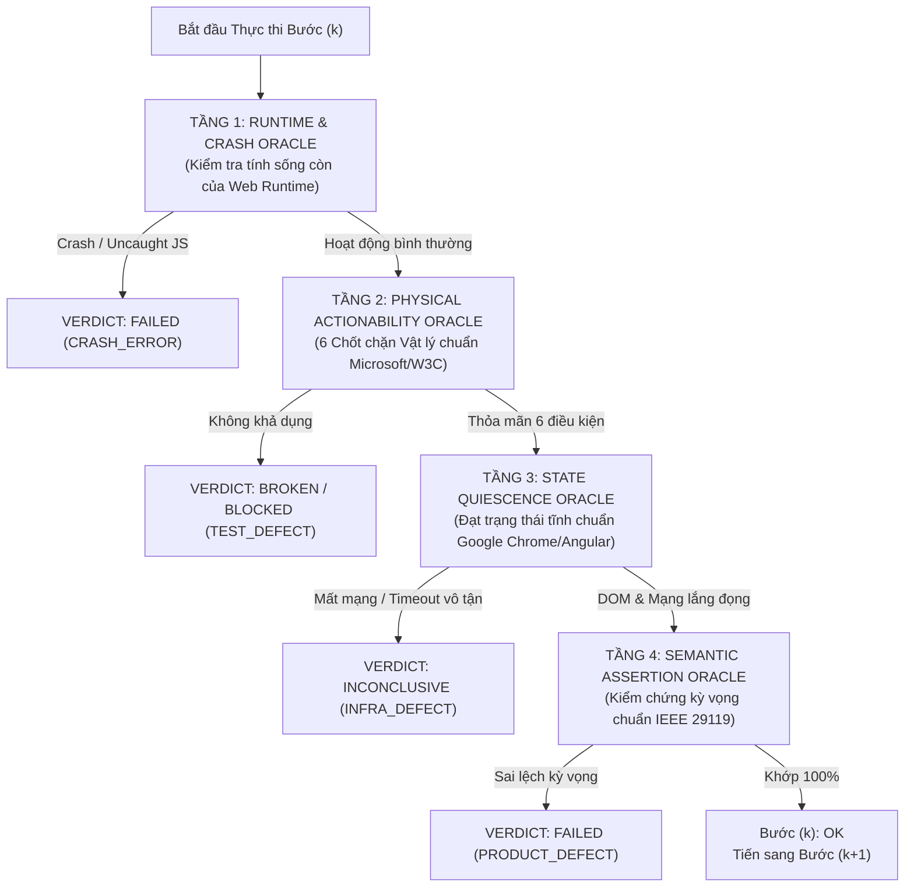

# TÀI LIỆU QUY CHUẨN ĐÁNH GIÁ KẾT QUẢ KIỂM THỬ (TEST EVALUATION & VERDICT SPECIFICATION)
*Dự án: Enterprise Zero-Selector Web AutoTest Engine*  
*Tiêu chuẩn tham chiếu: Google Test Engineering, Microsoft Playwright Actionability Spec, Meta Sapienz, W3C WebDriver BiDi, ISO/IEC/IEEE 29119*  
*Cập nhật: 17/11/2026 - Phiên bản 1.0.0*

---

## 1. MỤC ĐÍCH & PHẠM VI ÁP DỤNG

Tài liệu này xác lập bộ tiêu chuẩn kỹ thuật thống nhất để đánh giá kết quả kiểm thử tự động trên giao diện web (E2E Web Automated Testing). 

Mục tiêu cốt lõi:
1. **Triệt tiêu tính mập mờ (Eliminate Ambiguity)**: Không gộp mọi lỗi vào một chữ "FAIL" chung chung. Phân định rõ ràng giữa **Lỗi sản phẩm (Product Defect)**, **Lỗi kịch bản/UI thay đổi (Test Defect)** và **Lỗi hạ tầng môi trường (Infrastructure Defect)**.
2. **Triệt tiêu kết quả chập chờn (Eliminate Flakiness)**: Áp dụng cơ chế trạng thái tĩnh (State Quiescence) trước khi đánh giá, đảm bảo kết quả kiểm thử mang tính tất định 100% (Deterministic).
3. **Cung cấp bằng chứng pháp lý (Forensic Evidence)**: Mọi kết luận PASS/FAIL đều phải đi kèm bằng chứng thị giác (Visual Screenshot), nhật ký microsecond và dấu vân tay DOM (Fingerprint).

---

## 2. KIẾN TRÚC THẨM ĐỊNH 4 TẦNG ORACLE (THE 4 TEST ORACLES)

Mỗi bước trong kịch bản kiểm thử (từ bước 1 đến bước N) phải vượt qua đồng thời **4 tầng thẩm phán độc lập (Test Oracles)** theo chu trình khép kín:



---

### 2.1. Tầng 1: Runtime & Crash Oracle (Meta & Google Chrome Team)
Trước khi đánh giá bất kỳ tương tác nào, hệ thống phải xác nhận ứng dụng web không bị lỗi nghiêm trọng ngầm:

| Tiêu chuẩn kiểm tra | Điều kiện ĐẠT | Điều kiện VI PHẠM (Kích hoạt FAIL) |
| :--- | :--- | :--- |
| **Console Errors (SEV-1)** | Không có lỗi JavaScript unhandled (`window.onerror`, `UnhandledPromiseRejection`). | Xuất hiện lỗi cú pháp, vỡ bundle assets (404 JS/CSS), vỡ runtime React/Vue (`Hydration failed`, `ChunkLoadError`). |
| **Browser Process Liveness** | Render process của Chromium phản hồi tín hiệu CDP (Chrome DevTools Protocol) đều đặn. | Trình duyệt bị Crash, treo tab (OOM - Out Of Memory, White Screen of Death). |
| **Security & Frame Integrity** | Không vi phạm ranh giới bảo mật cơ bản làm tê liệt DOM. | Trình duyệt bị chuyển hướng ngoài mong muốn sang trang lỗi bảo mật độc hại. |

---

### 2.2. Tầng 2: Physical Actionability Oracle (Chuẩn 6 Chốt Chặn Microsoft Playwright & W3C)
Mọi thao tác can thiệp phần tử (`CLICK`, `FILL`, `HOVER`, `SELECT_ITEM`) bắt buộc phải thỏa mãn đồng thời 6 điều kiện vật lý:

1. **Attached**: Node mục tiêu phải liên kết thực sự vào cây DOM (không phải node mồ côi đang chờ Garbage Collection).
2. **Visible**:
   * Kích thước khung bao Bounding Box: $Width > 0$ và $Height > 0$.
   * Thuộc tính CSS hiển thị: `display !== 'none'`, `visibility !== 'hidden'`.
   * Độ trong suốt: `opacity > 0.05` (loại bỏ bẫy Honeypot ẩn).
3. **Stable (Geometry Quiescence)**: Tọa độ $(x, y)$ và kích thước không biến thiên trong tối thiểu 2 frame hoạt họa liên tiếp ($\Delta t \approx 100\text{ms}$). Đảm bảo hiệu ứng CSS trượt/phóng to đã dừng hẳn trước khi click.
4. **Enabled**: Không chứa thuộc tính `disabled`, `aria-disabled="true"` hoặc class CSS bị khóa (`is-disabled`, `btn-disabled`).
5. **Editable**: Đối với thao tác gõ (`FILL`, `SEARCH`), trường nhập liệu không được mang thuộc tính `readonly`.
6. **Receives Events (Hit-target Non-intercepted)**: Khi chiếu tia tọa độ vào tâm phần tử qua `document.elementFromPoint(x, y)`, phần tử trúng đích phải là chính nó hoặc con cháu trực tiếp của nó. Tuyệt đối không để lớp phủ Modal, Sticky Header, Backdrop hoặc Banner quảng cáo hứng mất sự kiện.

---

### 2.3. Tầng 3: State Quiescence Oracle (Trạng thái Tĩnh chuẩn Google)
Big Tech nghiêm cấm việc Assertion khi ứng dụng web đang trong quá trình chuyển giao trạng thái dở dang (In-flight state):

* **Event Loop Quiescence**: Hàng đợi Macro-tasks và Micro-tasks không còn hàm hẹn giờ (`setTimeout`, `setInterval`, `requestAnimationFrame`) đang biến đổi DOM.
* **Network Quiescence (Settlement Barrier)**: 
  * Số lượng request XHR/Fetch nghiệp vụ đang mở phải bằng 0 ($\text{Inflight Requests} = 0$).
  * Tự động lọc bỏ các kết nối vô tận không ảnh hưởng UI: Google Analytics, TikTok Pixel, Datadog/Sentry Heartbeat, WebWorker dài hạn.
* **DOM Mutation Quiescence**: `MutationObserver` ghi nhận DOM đứng yên trong khoảng đệm an toàn từ $300\text{ms} - 500\text{ms}$.
* **Zero-Effect Detection**: Sau khi Click, nếu cả URL lẫn DOM đều không có bất kỳ biến đổi nào sau 300ms, hệ thống lập tức kích hoạt sự kiện dự phòng Native Event Dispatch để kích hoạt Synthetic Listener của React/Vue.

---

### 2.4. Tầng 4: Semantic Assertion Oracle (Chuẩn ISO/IEC/IEEE 29119)
Khẳng định tính đúng đắn của logic nghiệp vụ theo hợp đồng kỳ vọng:

* **Strict Determinism**: Phép so khớp giữa Giá trị Thực tế ($V_{\text{actual}}$) và Kỳ vọng ($V_{\text{expected}}$) dựa trên toán tử toán học chính xác:
  * `EQUALS`: So khớp tương đương chính xác từng ký tự (đã chuẩn hóa khoảng trắng thừa).
  * `CONTAINS`: Chuỗi con tồn tại trong chuỗi mẹ hiển thị.
  * `ABSENT`: Xác nhận biến mất hoàn toàn (VD: Spinner "Đang tải..." biến mất).
  * `DISABLED`: Trạng thái bị khóa của phần tử.

---

## 3. HỆ THỐNG PHÂN LOẠI KẾT LUẬN CHUẨN QUỐC TẾ (VERDICT TAXONOMY)

Một kịch bản kiểm thử sau khi chạy xong sẽ được xếp vào chính xác **1 trong 4 trạng thái** chuẩn quốc tế:

| Verdict (Kết luận) | Mã nội bộ | Định nghĩa tiêu chuẩn | Trách nhiệm xử lý |
| :--- | :--- | :--- | :--- |
| **`PASSED`** | `TEST_PASSED` | Thỏa mãn $100\%$ cả 4 tầng Oracle từ bước $1$ đến bước $N$. Bằng chứng xanh hợp lệ. | **Release Ready**: Đủ điều kiện triển khai ra môi trường Production. |
| **`FAILED`** | `PRODUCT_DEFECT` | Cả 3 tầng Oracle kỹ thuật đều đạt, nhưng **Tầng 4 Assertion bị sai lệch**. Web chạy tốt nhưng hiển thị sai nghiệp vụ (sai giá tiền, sai thông báo lỗi, sai đường dẫn URL). | **Developer**: Gán Ticket trực tiếp cho đội phát triển phần mềm sửa code nghiệp vụ. |
| **`BROKEN / BLOCKED`** | `TEST_DEFECT` | Kịch bản không thể đi tiếp do vi phạm Tầng 2 (Phần tử không tìm thấy, bị disabled, bị modal che, tester viết kịch bản sai đối tượng). | **QA / Automation Engineer**: Cập nhật kịch bản hoặc tinh chỉnh từ khóa nhận diện. |
| **`INCONCLUSIVE`** | `INFRA_DEFECT` | Sự cố ngoài tầm kiểm soát của ứng dụng: Rớt mạng internet, DNS Timeout, Cổng thanh toán bên thứ ba sập, máy ảo CI/CD bị quá tải CPU/RAM. | **DevOps / SRE**: Tự động đưa bài test vào hàng đợi chạy lại (Quarantine & Retry). |

---

## 4. BỘ TIÊU CHUẨN NGHIỆM THU TỪNG HÀNH ĐỘNG NGUYÊN TỬ (PER-ACTION SPECIFICATION)

Để một bước con được đánh giá là `OK`, hành động tương ứng phải đáp ứng các tiêu chí chi tiết sau:

```text
┌─────────────────┬────────────────────────────────────────────────────────────────────────┐
│ HÀNH ĐỘNG       │ ĐIỀU KIỆN ĐÁNH GIÁ ĐẠT (OK)                                            │
├─────────────────┼────────────────────────────────────────────────────────────────────────┤
│ CLICK           │ 1. Phần tử vượt qua 6 chốt chặn Actionability.                         │
│                 │ 2. Sự kiện Click vật lý kích hoạt thành công.                          │
│                 │ 3. Tạo ra biến đổi trạng thái (DOM Mutated hoặc URL Changed).           │
├─────────────────┼────────────────────────────────────────────────────────────────────────┤
│ FILL            │ 1. Ô nhập liệu focus thành công, xóa sạch giá trị cũ.                  │
│                 │ 2. Gõ đúng chuỗi ký tự giá trị mới.                                    │
│                 │ 3. Giá trị input.value sau khi gõ phải khớp 100% với giá trị kỳ vọng.  │
├─────────────────┼────────────────────────────────────────────────────────────────────────┤
│ SEARCH          │ 1. Điền từ khóa vào ô tìm kiếm thành công.                             │
│                 │ 2. Gửi tín hiệu phím Enter (hoặc click nút tìm kiếm kế cận).           │
│                 │ 3. Quiescence Barrier xác nhận trang bắt đầu tải kết quả mới.          │
├─────────────────┼────────────────────────────────────────────────────────────────────────┤
│ SELECT_ITEM     │ 1. Xác định danh sách lặp (Product/Article/Video Cards).               │
│                 │ 2. Chọn đúng vị trí thứ N theo thứ tự vật lý từ trên xuống dưới.       │
│                 │ 3. Kích hoạt chuyển trang hoặc mở modal chi tiết item đó.              │
├─────────────────┼────────────────────────────────────────────────────────────────────────┤
│ SCROLL          │ 1. Thực hiện cuộn màn hình mượt mà đúng chiều (DOWN/UP/TOP/BOTTOM).    │
│                 │ 2. window.scrollY hoặc scrollX có sự thay đổi tọa độ thực tế.          │
│                 │ 3. Đợi các tài nguyên Lazy Loading tải xong.                           │
├─────────────────┼────────────────────────────────────────────────────────────────────────┤
│ ASSERT_TEXT     │ 1. Văn bản kỳ vọng xuất hiện trong innerText của màn hình hiển thị.     │
│                 │ 2. Không tính các đoạn text ẩn trong script, style, comments.          │
├─────────────────┼────────────────────────────────────────────────────────────────────────┤
│ ASSERT_URL      │ 1. window.location.href chứa đúng chuỗi URL kỳ vọng trong timeout.     │
├─────────────────┼────────────────────────────────────────────────────────────────────────┤
│ WAIT            │ 1. Tiến trình nín thở đúng số milli-giây chỉ định (sai số ±5%).        │
│                 │ 2. Không xảy ra crash trình duyệt trong lúc chờ.                       │
└─────────────────┴────────────────────────────────────────────────────────────────────────┘
```

---

## 5. NGUYÊN TẮC VẬN HÀNH & XỬ LÝ LỖI (STRICT OPERATIONAL RULES)

### 5.1. Triết lý Fail-Fast Tuyệt đối (Strict Fail-Fast)
> [!IMPORTANT]
> Khi bất kỳ bước $k$ nào trong kịch bản $1 \dots N$ bị đánh giá là không đạt (`FAILED`, `BROKEN` hoặc `INCONCLUSIVE`):
> * **Dừng khẩn cấp ngay lập tức**: Hủy bỏ toàn bộ việc thực thi các bước từ $k+1$ đến $N$.
> * **Tuyệt đối không tự ý đi đường vòng**: Không tự ý reload trang, không tự click bừa vào phần tử khác để "chữa cháy" trừ khi kịch bản có chỉ định rõ ràng.
> * **Bảo toàn hiện trường**: Giữ nguyên trạng thái DOM và viewport tại bước $k$ để phục vụ công tác chụp ảnh bằng chứng.

### 5.2. Chuẩn hóa Bằng chứng Cứu hộ (Forensic Evidence Bundle)
Mọi kết quả kiểm thử khi kết thúc bắt buộc phải xuất ra gói bằng chứng gồm:

1. **Bằng chứng Thị giác (Visual Screenshot)**:
   * **Khi PASSED**: Chụp ảnh `pass_step_N.png` kèm Banner màu xanh `#16a34a` ở góc màn hình xác nhận hoàn thành $N/N$ bước.
   * **Khi FAILED**: Chụp ảnh `fail_step_k.png` kèm:
     * Khung khoanh vùng chữ nhật màu đỏ `#dc2626` trực tiếp lên phần tử gây lỗi (Bounding Box).
     * Banner thông báo đỏ ở góc trên màn hình ghi rõ: Bước $k$ FAILED, lý do kỹ thuật chi tiết.
2. **Nhật ký Thực thi (Structured JSON Log)**:
   * Ghi nhận từng bước: `stepNumber`, `instruction`, `status (OK/FAILED)`, `durationMs`, `reasonCode`, `detail`.
3. **Bộ đệm Vân tay (Fingerprint Dataset Cache)**:
   * Lưu trữ các selector bền vững, thẻ tag, aria-label, stable classes vào `output/trace_dataset.json` để tăng tốc cho các lần chạy tiếp theo.

---

## 6. LỘ TRÌNH ÁP DỤNG TRONG ENGINE

Tài liệu này là căn cứ pháp lý kỹ thuật cao nhất cho hệ thống kiểm thử:
- [x] Đã áp dụng 5 Cổng kiểm soát thực thi trong [src/runner.ts](file:///e:/SourceCode/autotest/src/runner.ts).
- [x] Đã chuẩn hóa mã lỗi chuẩn `FailureReasonCode` trong [src/types.ts](file:///e:/SourceCode/autotest/src/types.ts).
- [x] Đã triển khai nín thở Action Settlement Barrier trong [src/settlement-barrier.ts](file:///e:/SourceCode/autotest/src/settlement-barrier.ts).
- [ ] Tiếp tục mở rộng hỗ trợ phân loại rạch ròi 4 trạng thái Verdict (`PASSED`, `PRODUCT_DEFECT`, `TEST_DEFECT`, `INFRA_DEFECT`) trong bản cập nhật Runner tiếp theo.
