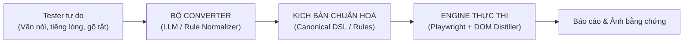

# TÀI LIỆU QUY CHUẨN KỊCH BẢN KIỂM THỬ (CANONICAL SCENARIO SPECIFICATION)
*Dự án: Enterprise AutoTest Engine (Zero-Selector Architecture)*  
*Mục đích: Tách biệt hoàn toàn lớp chuyển đổi ngôn ngữ (Converter) và lớp thực thi tự động (Execution Engine).*

---

## 1. TỔNG QUAN KIẾN TRÚC TÁCH LỚP (SEPARATION OF CONCERNS)

Để hệ thống không bị "cứng" nhưng vẫn đảm bảo độ tin cậy tuyệt đối (100% Deterministic) khi chạy kiểm thử, hệ thống chia làm 2 tầng độc lập:



* **Lớp 1 - Converter (Chuyển đổi)**: Chịu trách nhiệm thấu hiểu mọi loại văn phong của tester (từ ngữ lóng, thiếu dấu, viết tắt, bước gộp phức tạp) và biên dịch về **Cú pháp chuẩn (Canonical DSL)**.
* **Lớp 2 - Execution Engine (Thực thi)**: Chỉ nhận cú pháp chuẩn. Không phải đoán già đoán non ngữ nghĩa câu chữ, tập trung 100% năng lực vào:
  * Quét DOM hình học thực tế (Spatial Geometry, Shadow DOM, Iframe).
  * Chống click trượt (Hit-testing, Action Settlement Barrier).
  * Chụp ảnh bằng chứng và báo cáo PASS/FAIL.

---

## 2. BỘ QUY TẮC CÚ PHÁP CHUẨN (CANONICAL DSL)

Mỗi kịch bản là một tập hợp các bước đánh số thứ tự `(1), (2), (3)...`. Mỗi bước đại diện cho **1 hành động nguyên tử duy nhất (Atomic Action)**. Nếu người dùng nhập bước gộp, Converter phải tự động tách thành các bước con liên tiếp.

### 2.1. Danh mục hành động chuẩn (Canonical Atomic Actions)

#### A. Nhóm tương tác cơ bản (Core Interactions - Phủ 85% nhu cầu thông thường):
| Mã hành động | Cú pháp chuẩn hóa (Khuyên dùng) | Tham số bắt buộc | Ý nghĩa thực thi |
| :--- | :--- | :--- | :--- |
| **CLICK** | `Bấm "[tên_nút_hoặc_link]"` | `targetHint` | Tìm và click nút, link, tab, menu |
| **FILL** | `Điền "[giá_trị]" vào ô "[tên_ô]"` | `targetHint`, `value` | Focus ô input/textarea, xóa cũ và gõ mới |
| **SEARCH** | `Tìm kiếm "[từ_khóa]"` | `value` | Điền vào ô tìm kiếm và tự động nhấn `Enter` |
| **SELECT_ITEM** | `Chọn [sản phẩm / tin tức / video] thứ [N]` | `itemIndex` (số nguyên >= 1) | Click vào thẻ nội dung (Card/Article/Video) thứ N từ trên xuống |
| **SCROLL** | `Cuộn xuống [X]px` / `Cuộn lên [X]px`<br>`Cuộn xuống cuối trang` / `Cuộn lên đầu trang` | `direction`, `amount` | Cuộn màn hình để tải dữ liệu Lazy Load / Infinite Scroll |
| **PRESS_KEY** | `Nhấn phím [Enter / Escape / Tab / Space]` | `keyName` | Gửi tín hiệu bàn phím vật lý vào trang |
| **WAIT** | `Chờ [X] giây` | `waitMs` | Tạm dừng chủ động (chờ animation, video chạy) |
| **ASSERT_TEXT** | `Kiểm tra hiện chữ "[nội_dung]"` | `expectedText` | Xác nhận văn bản xuất hiện trên màn hình hiển thị |
| **ASSERT_URL** | `Kiểm tra URL chứa "[chuỗi_url]"` | `expectedUrlPart` | Xác nhận trình duyệt đã điều hướng đến đúng URL |
| **HOVER** | `Rê chuột vào "[mục_tiêu]"` | `targetHint` | Kích hoạt hiệu ứng rê chuột (menu dropdown hover) |
| **NAVIGATE_BACK**| `Quay lại trang trước` | *Không có* | Nhấn nút Back trên trình duyệt |
| **RELOAD** | `Tải lại trang` | *Không có* | Làm mới lại trang (F5) |

#### B. Nhóm hành động thực tế quan trọng CẦN BỔ SUNG (Phủ nốt 15% còn lại của Web App thực tế):
| Mã hành động | Cú pháp chuẩn hóa | Tham số | Ý nghĩa thực tế |
| :--- | :--- | :--- | :--- |
| **SELECT_OPTION** | `Chọn "[giá_trị]" trong danh sách "[tên_ô]"` | `targetHint`, `value` | Thao tác thẻ `<select>` thả xuống (Chọn tỉnh/thành, phân loại hàng, size số) |
| **CHECK** | `Tích chọn ô "[tên_checkbox]"` | `targetHint` | Đảm bảo checkbox/radio được chọn (Nếu đã chọn thì giữ nguyên, không toggle tắt) |
| **UNCHECK** | `Bỏ tích ô "[tên_checkbox]"` | `targetHint` | Đảm bảo checkbox được bỏ chọn |
| **UPLOAD_FILE** | `Tải file "[đường_dẫn_tệp]" vào ô "[tên_ô_upload]"` | `targetHint`, `filePath` | Đính kèm file ảnh đại diện, file tài liệu vào `<input type="file">` |
| **SWITCH_TAB** | `Chuyển sang tab mới` / `Đóng tab hiện tại` | `tabAction` | Xử lý khi bấm link mở tab mới (VNPay, Shopee Mall, link tài liệu) |
| **HANDLE_DIALOG** | `Chấp nhận hộp thoại` / `Hủy hộp thoại` | `dialogAction` | Xử lý Popup gốc trình duyệt: `alert()`, `confirm()`, `prompt()` |
| **ASSERT_NOT_TEXT**| `Kiểm tra không còn hiện chữ "[nội_dung]"` | `expectedText` | Xác nhận trạng thái tải xong (chữ "Đang tải...", "Loading..." đã biến mất) |
| **ASSERT_DISABLED**| `Kiểm tra ô/nút "[tên_nút]" đang bị khóa` | `targetHint` | Xác nhận nút bị mờ/disabled (VD: nút Mua Hàng bị khóa khi chưa điền thông tin) |

---

### 2.2. Quy tắc bao bọc tham số (Quoting Rule)

> [!IMPORTANT]
> Mọi chuỗi ký tự tự do (từ khóa tìm kiếm, giá trị nhập, tên nút, nội dung kiểm tra) **BẮT BUỘC** phải được bọc trong dấu ngoặc kép `"` hoặc dấu backtick `` ` ``.
> * **Chuẩn**: `Điền "admin@test.com" vào ô "Email"`
> * **Không chuẩn**: `Điền admin@test.com vào ô Email` (dễ gây nhập nhằng khi tên ô hoặc giá trị có dấu cách).

---

## 3. VÍ DỤ CHUYỂN ĐỔI THỰC TẾ (BEFORE VS AFTER)

### Ví dụ 1: Mua hàng E-commerce
* **Tester gõ tự do**:  
  *"Vào shop search chuột logitech rồi lăn chuột xuống tí click con đầu tiên xong ấn mua ngay"*
* **Converter chuẩn hóa ra**:
  ```text
  (1) Tìm kiếm "chuột logitech"
  (2) Cuộn xuống 600px
  (3) Chọn sản phẩm thứ 1
  (4) Bấm "Mua ngay"
  ```

### Ví dụ 2: Đăng nhập hệ thống
* **Tester gõ tự do**:  
  *"Gõ user standard_user với pass secret_sauce rồi login kiểm tra xem vào dc trang products chưa"*
* **Converter chuẩn hóa ra**:
  ```text
  (1) Điền "standard_user" vào ô "Tài khoản"
  (2) Điền "secret_sauce" vào ô "Mật khẩu"
  (3) Bấm "Đăng nhập"
  (4) Kiểm tra hiện chữ "Products"
  ```

### Ví dụ 3: Đọc báo tin tức
* **Tester gõ tự do**:  
  *"Xem có chữ Dân trí không, kéo xuống một đoạn rồi bấm sang mục kinh doanh check xem link có đổi không"*
* **Converter chuẩn hóa ra**:
  ```text
  (1) Kiểm tra hiện chữ "Dân trí"
  (2) Cuộn xuống 600px
  (3) Bấm "Kinh doanh"
  (4) Kiểm tra URL chứa "kinh-doanh"
  ```

---

## 4. PHÂN TÍCH CÁCH LÀM BỘ CONVERTER

Để bạn dễ dàng tự xây dựng bộ Converter, đây là 3 phương án kiến trúc khả thi:

### Phương án A: Dùng LLM Prompting Siêu Nhẹ (Khuyên dùng)
* **Cơ chế**: Dùng một model nhẹ (như `gemini-2.5-flash` hoặc model local qua Ollama) với System Prompt chứa bảng 12 quy tắc trên + 3 ví dụ Few-Shot.
* **Đặc điểm**:
  * Hiểu được 100% tiếng lóng, tiếng Việt gõ không dấu, văn phong vùng miền.
  * Tự động nhận diện bước gộp ("rồi", "xong", "sau đó") để tách thành các bước con `(1), (2), (3)`.
  * Thời gian phản hồi: ~200ms - 500ms cho 1 đoạn kịch bản.

### Phương án B: Rule-based Tokenizer kết hợp Từ điển Từ đồng nghĩa
* **Cơ chế**:
  * Bước 1: Chuẩn hóa bỏ dấu, tách câu bằng dấu phẩy, liên từ nối (`rồi`, `sau đó`, `tiếp tục`).
  * Bước 2: Bắt động từ chính (`bấm/ấn/click/chọn/gõ/nhập/tìm/kiểm tra/kéo/cuộn`).
  * Bước 3: Trích xuất đối tượng và bọc ngoặc kép tự động.
* **Đặc điểm**: Chạy offline 100%, 0ms, không tốn tiền API nhưng sẽ cần bảo trì từ điển từ lóng liên tục nếu tester viết quá quái dị.

### Phương án C: Hybrid (Bộ lọc 2 tầng)
* Tầng 1: Chạy Rule-based nhanh. Nếu nhận diện đủ 100% mẫu câu chuẩn ➔ Chuyển thẳng sang Engine.
* Tầng 2: Nếu câu cú lộn xộn hoặc có từ lạ chưa nhận diện được ➔ Đẩy sang LLM Prompting để chuyển đổi.

---

## 5. KẾ HOẠCH BÀN GIAO TIẾP THEO

- [x] Định nghĩa hoàn tất chuẩn DSL trong [QUY_CHUAN_KICH_BAN.md](file:///e:/SourceCode/autotest/QUY_CHUAN_KICH_BAN.md).
- [ ] Bạn triển khai Converter để biến văn phong tự do thành chuẩn trên.
- [ ] Engine giữ nguyên bộ phân tích ổn định, sẵn sàng nhận kịch bản chuẩn và chạy đạt 100%.
